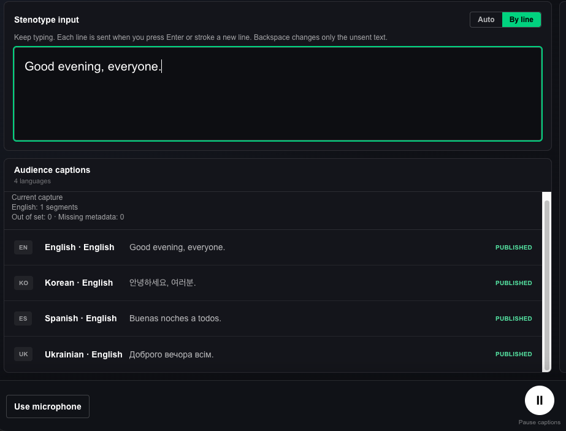

Live subtitles and captions do not always begin with a microphone.

At conferences, post-show discussions, public events and accessible performances, the words audiences read may be written by a professional stenographer as people speak. Stenographers listen while using their own equipment, dictionaries and input methods to turn speech into readable text. The work calls for more than speed: names, specialist vocabulary, punctuation, sentence structure and judgement about context all matter.

Pockitle Live originally focused on speech recognition: it takes live audio, produces captions in the source language and can translate them into additional languages. We have now added a separate path for **text written live by a person**.

This is Pockitle Live's **stenotype input mode**. The basic implementation has been built and tested. Our next step is to try it with people who actually work in professional stenography and live captioning.

## Keep the tools you already know

We are not trying to recreate stenography software inside a browser, or asking stenographers to change the way they work.

The current mode accepts text from an ordinary keyboard, and **Plover** is one of the primary workflows we have designed around. A stenographer can continue using their own machine, dictionaries and Plover settings. Plover converts their strokes into text and sends it to the Pockitle Live writing field just as it would type into another application.

There is no special Plover plugin to install. Pockitle does not interpret raw stenotype strokes or require anyone to upload a personal dictionary.

**The stenographer writes the text. Pockitle receives it, segments it and delivers it.**

## No need to press Send after every sentence

Continuous stenography has its own rhythm. Requiring a separate Send click every time a sentence is completed would interrupt it.

That is why the text-input mode offers two ways to submit captions.

In **Auto mode**, the system looks first for sentence endings and punctuation. When the stenographer begins the next sentence, or pauses briefly after completing one, the preceding sentence can be submitted automatically. Longer text without suitable punctuation is also divided using bounded waiting and length rules so it does not sit indefinitely in the draft.

In **By line mode**, the stenographer controls the end of each line. A line is submitted only after Enter creates a newline; punctuation or a pause will not send an unfinished line.

*By line input and published English, Korean, Spanish and Ukrainian captions in the English interface.*

In either mode, the current draft remains editable **until it is submitted**, including through Plover undo and rewriting. Before submission, the writing field is still the stenographer's working space.

There is an equally important boundary: **once a caption has been accepted and published, later Backspace operations cannot retract or rewrite it**. Subsequent input becomes a new caption segment. This keeps the audience display stable, but it also makes the submission point something to practise during a rehearsal.

## Human-written originals, system-generated translations

In stenotype mode, Pockitle Live does not need to open the microphone or run speech recognition on what the stenographer has typed.

The current workflow configures **one source language** for a text-input session. The stenographer's words become the original captions. Once accepted, they can appear on the configured audience view or venue display. If other languages are needed, the submitted text can also be sent through the existing translation process to generate translated captions.

Audience members can still open a link or scan a QR code, select a language offered by the event and read captions in their phone browser. They do not need to install an audience app.

The translated captions are not the same thing as the stenographer's original text. Translation adds processing time and may make mistakes with names, terminology, context or sentence boundaries. A professionally written original does not mean the translated versions have been reviewed by a human translator.

The aim is to let the stenographer concentrate on the original-language text while one delivery system helps that text reach audiences reading different languages.

## One console for the performance

Stenotype mode does not create a separate performance system. The operator continues using the existing Pockitle Live console, audience link and caption displays.

Before the event, the operator can choose **Use stenotype** and check that the writing field accepts text, deletion and rewriting. At this point the words remain an unpublished draft; they do not appear automatically on audience screens. Selecting **Start captions** begins submission according to the chosen mode. Any test words should be cleared first so they are not sent by mistake.

**Pause captions** stops new automatic submissions and retains the unsent draft while the page remains open. At the end of the performance, the system attempts to submit remaining text before closing. Segments already in flight may still reach the audience while a Pause is being completed.

The operator still needs to watch connection and delivery status. Text whose acceptance has not been confirmed must not be treated as successfully published. Leaving or refreshing the page can also lose an unsent local draft.

These details may attract less attention than the number of languages on offer, but they are essential to anyone who relies on continuous text input as part of their work.

## An invitation to professional stenographers: try it for free

Our basic tests show that Pockitle Live can accept operator-written text, segment it under the selected rules and send it through the existing caption-delivery workflow. What we most want to learn now is **whether it feels right in a professional stenographer's everyday practice**.

Stenographers differ in their keyboards, dictionaries, undo habits and punctuation styles. Some prefer uninterrupted sentence-by-sentence writing; others want to decide exactly when a line ends. A lecture, a theatre discussion and a conference may also have different expectations for delay and readability.

We are particularly interested in how the mode behaves during sustained writing, the timing of submitted text, Plover's undo behaviour, interruptions to writing-field focus, and the readability of original and translated captions on audience devices.

**If you are a professional stenographer or realtime captioner, we invite you to try Pockitle Live's stenotype input mode free of charge and share your experience.** Whether you work with Plover or want to test ordinary keyboard input alongside multilingual caption delivery, we would welcome your feedback.

Email **[info@pockitle.com](mailto:info@pockitle.com)** with a short description of your software, equipment and the setting you would like to test. We will agree on the trial arrangements and scope individually.

This is an invitation to evaluate a practical workflow, not a claim that every stenotype device has been qualified or that the service holds a professional accessibility-captioning certification. Production use should still be tested and rehearsed for the actual venue and requirements.

We want Pockitle Live to do more than turn sound into words. We want it to carry **words written by skilled people** to the audiences who need to read them.
