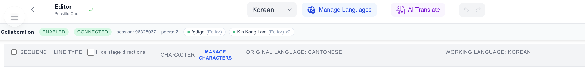
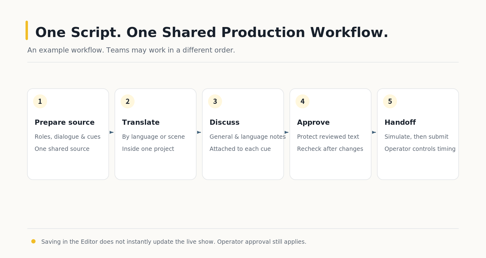
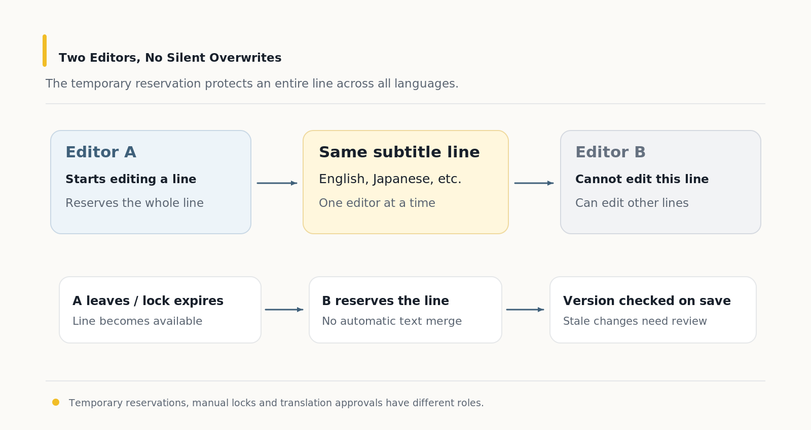
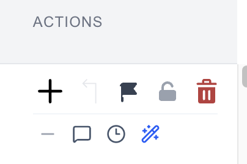
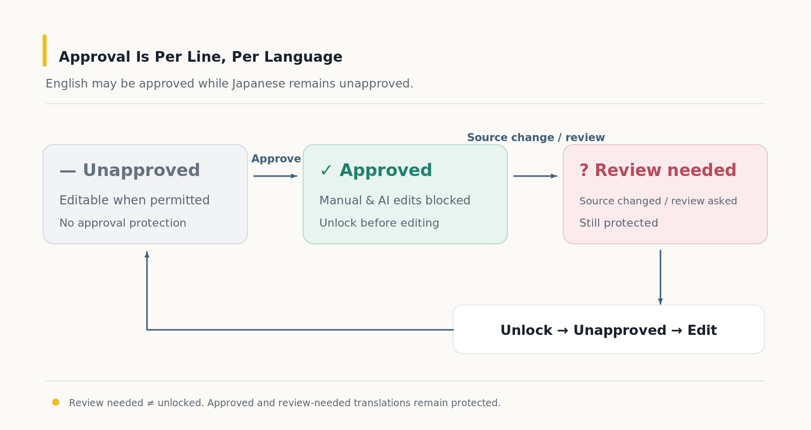

Surtitles for a production rarely pass through just one pair of hands.

Someone prepares the script, someone translates it, and someone checks the wording. A director may revise dialogue after rehearsal. The surtitles operator needs to know which version is meant for tonight's performance.

Imagine a production preparing English and Japanese surtitles. The English translator has approved Act One; the Japanese translator is still revising several lines. Then the director changes a sentence in the source script.

Does the approved English version need another review? Will the Japanese translator know that the source has changed? What happens if a second editor saves an old version of a line while a colleague is working on it?

Putting a document in the cloud does not, by itself, answer those questions.

**Meaningful collaboration is not simply opening the same script at the same time. Everyone needs to know what is being edited, which translations are approved, and what needs to be reviewed again.**

Those are the problems behind the collaborative design of Pockitle Cue Editor.

Real-time collaboration depends on an eligible plan, editor permissions and availability; it is not active for every account.

## One script instead of several competing versions

Scripts and translations often travel as separate files. The original is in Word; the English translation is in one spreadsheet; a Japanese translator manages another copy. Rehearsal changes arrive later by email or chat.

Everyone may have done their part correctly. The hard work starts when the team has to discover which copy contains the latest change.

Pockitle Cue Editor keeps source text, translations in different working languages, character information and surtitle order in one project. Translators choose the language they are working on and edit beside the source. Production staff can review roles, stage directions, line order and segmentation. Team members view or change shared material according to their account permissions.

This does not prescribe a rigid production sequence. One team may translate first; another may establish characters before translation. Some questions cannot be settled until rehearsal. What matters is that the work returns to the same script.

*Figure 1. One possible multilingual surtitle workflow. Teams may overlap or reorder these activities; it is not a mandatory five-step process.*

## Sharing a script does not mean editing the same line freely

Two people can work in the same script, but Pockitle Cue does not allow unrestricted simultaneous changes to one line.

When an editor begins working on a line, the system temporarily reserves that entire row. Colleagues can keep editing other lines, but cannot submit competing changes to the reserved one—or delete or merge it while another editor is working there. The restriction is checked by the server, not merely indicated on screen.

**A temporary editing reservation covers the whole row across its languages.** If one translator is editing the English text, another cannot simultaneously change the Japanese translation of that same row. They can still work on different rows.

This is deliberate. We want a team to divide the work, not have two people rewrite the same material and leave the software to guess whose words should survive.

*Figure 2. Temporary row reservations and version checks. These are different from a manual row lock and from translation approval.*

The reservation is released when the editor leaves the line, and an abandoned reservation eventually expires. Once another editor obtains it, saving still checks whether the underlying content has changed. A genuine conflict is not resolved by silently overwriting a newer version with an older one.

## English approved does not mean Japanese approved

“Finished” is not necessarily a single state for a multilingual surtitle line.

The English translation may be signed off while the French version awaits checking and the Japanese version still needs the director's attention.

That is why approval in Pockitle Cue works **per line and per language**. Approving English does not automatically approve Japanese.

An unapproved translation has a grey indicator. Approval changes it to a green check and protects the saved text. A red question mark means that the translation needs review.

In each row’s Actions, the dash, check or question mark indicates translation approval. The speech bubble opens line comments, the clock opens earlier wording, and the wand opens AI refinement. The padlock is a manual row lock, distinct from approval and a temporary collaboration reservation; the flag marks a line for attention.

The critical distinction is this: **needs review does not mean anyone may immediately rewrite it.** Approved translations and translations awaiting review are both protected. An editor must explicitly unlock the language-specific translation before changing its text, then decide whether to approve the new wording.

*Figure 3. Approval belongs to an individual line and language. Both green and red states prevent ordinary manual or AI operations from overwriting protected wording.*

### When the source changes, approved translations deserve another look

Return to our rehearsal example.

If the director changes a source line, translations that were already protected are marked for another review. The system does not assume yesterday's translation is still right, and it does not decide the replacement wording on the translator's behalf.

Instead, it makes the dependency visible: **the source has changed, so the previous approval should be reconsidered.**

For a multilingual production, that warning can be more useful than immediately generating another translation.

## Keep a discussion beside the line it concerns

Reviewing surtitles involves more than finding spelling errors.

Should a character's form of address sound more intimate? Should a joke retain a pun or prioritise what the audience can understand? If a director wants a colder delivery, should the translation change?

Those conversations may happen in chat, email or the rehearsal room. A few days later, another translator may take over without knowing why a particular choice was made.

Pockitle Cue Editor lets authorised team members leave comments on a particular surtitle line. A comment can be general or tied to one translation language; the discussion shows its author and time, giving the next person a way to understand what was raised earlier.

Comments are separate from the surtitle text. Writing a note does not edit the words an audience will see, and the discussion does not automatically email colleagues. It is not intended to replace a team's messaging tools. Its purpose is to **keep a decision that only makes sense beside a particular line attached to that line.**

## See earlier wording—and know whether today's edit was saved

One line may go through several revisions over the course of a production. Editor provides a history of previously saved source wording and translations in the selected working language, including manual edits and certain earlier versions preserved before whole-script translation overwrites.

History and comments serve different purposes: comments preserve discussion, while history preserves earlier text. The history is currently for viewing; it is not a one-click system for restoring the entire script to any past point in time.

Saving also has safeguards. The Editor autosaves, and an explicit Save submits your own pending edits across different lines and working languages. It does not replace the server's document with an old browser-wide snapshot.

When a save fails or conflicts with a newer version, unsaved text for a line and language that still exist remains in its original cell so the editor can compare and retry. That is not a permanent offline draft backup. Check the save status before leaving or reloading the page.

## AI can suggest changes, but it cannot bypass approval

AI translation can help produce a draft or suggest improvements to an individual translation. In a shared script, however, new wording is only part of the problem.

Suppose an English translator has reviewed and approved a line. Another colleague then starts a whole-script translation. That action should not quietly replace the approved English text.

Protected translations are therefore skipped by ordinary AI translation. A single-line AI refinement separates generating a suggestion from applying it. If the source or current translation has changed since the suggestion was produced, the old suggestion cannot simply be applied over the newer content.

During a whole-script translation job, shared editing controls become read-only. Editing resumes after the saved results have been synchronised, so a batch translation and multiple editors do not compete to write the same material.

Teams that do not want generative AI can disable it at organisation level and continue editing and reviewing manually. This is not a universal switch for every cloud language service, nor does it make the Editor an offline application.

## From rehearsal to the stage, one more decision remains

Rehearsals bring changes to lines, timing and sometimes cue order. Saving those changes in the Editor does not mean that a deployed audience display changes instantly.

If a show is running, or its operator console already controls the performance, subtitle updates are submitted separately and applied by the operator at a suitable moment. Translators and production staff can continue preparation while the person following the performance retains control of when new content goes live.

**Translation complete, team approval and a live show update are related—but they are not the same decision.**

## Let the script carry the team's work forward

A small theatre may need only a translator and a producer reviewing their work. A multilingual production may bring together several translators, reviewers and technical staff, each contributing at a different time.

They do not all need to be online together. They do need to understand how their work connects.

When judging a collaborative surtitle editor, the useful question is not simply how many people can log in. It is whether the next colleague can see which line is being edited, which language has been approved, why a translation needs another look, and when the content is ready to hand over to the stage.

**The aim of Pockitle Cue Editor is to let different people complete the surtitles without making every handoff another exercise in reconstructing work the team has already done.**

Learn more: [Pockitle Cue](https://surtitlelive.com/) · [Editor user guide](https://surtitlelive.com/guides/open-editor)
