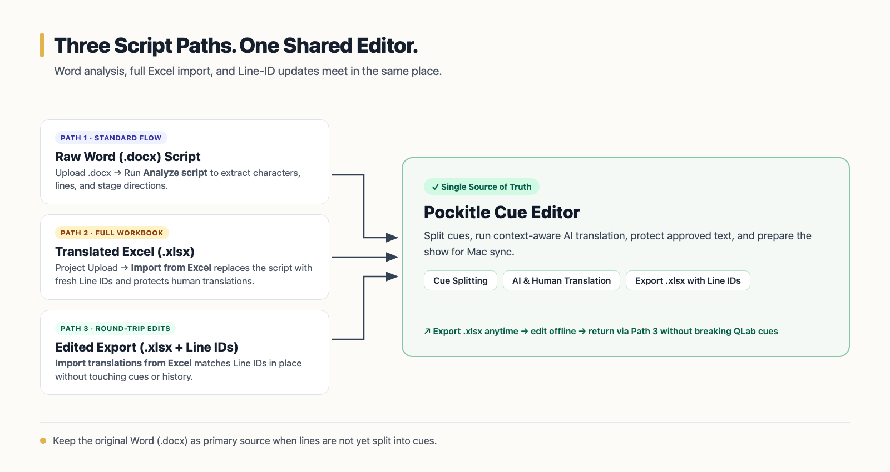
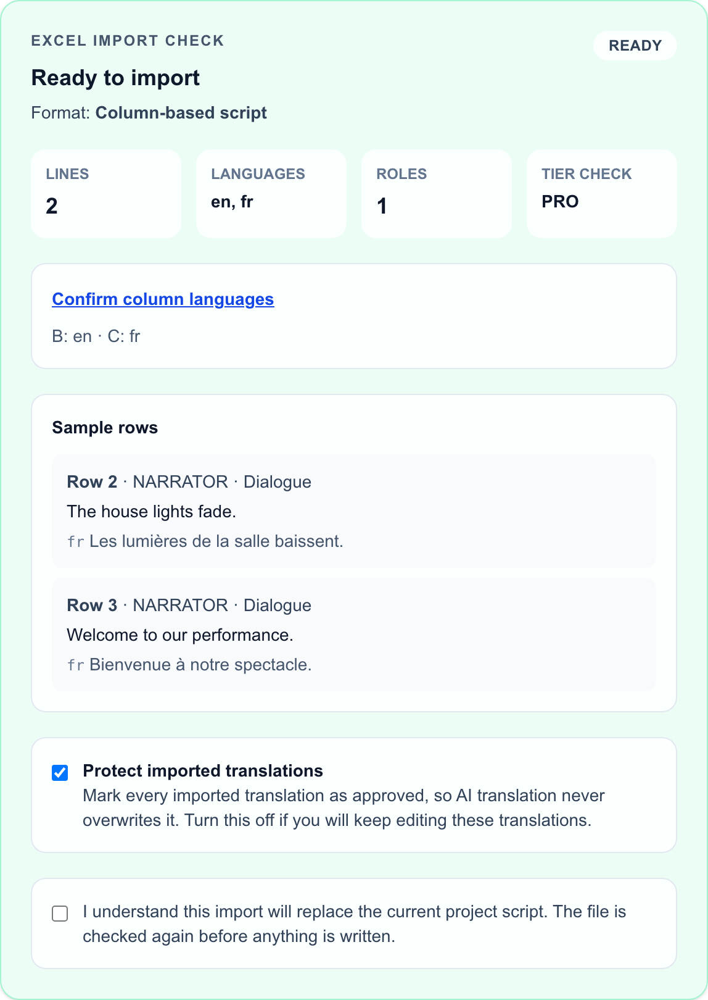
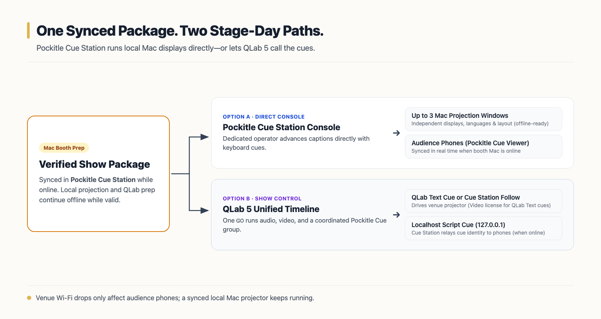
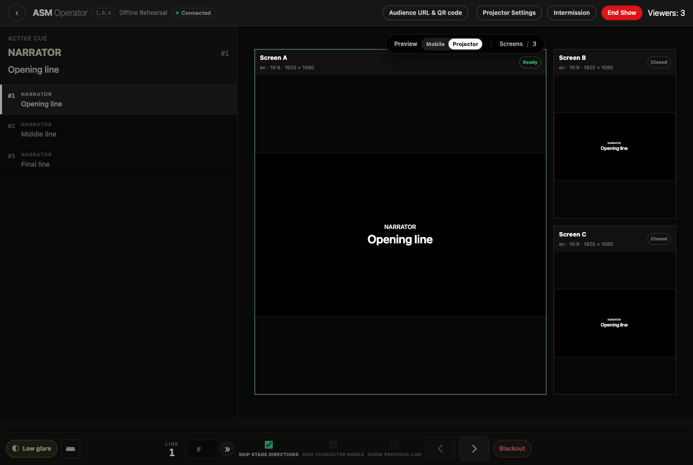
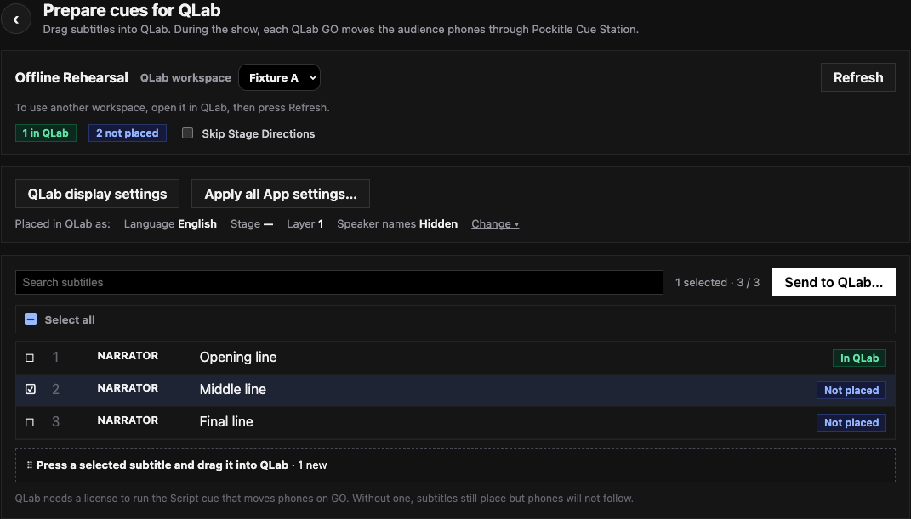
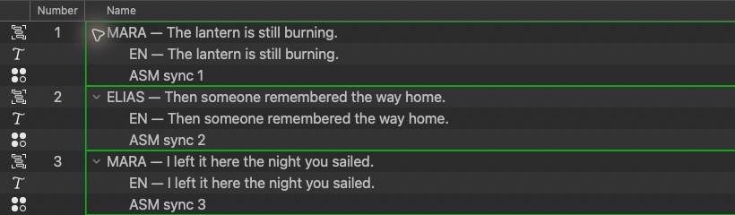
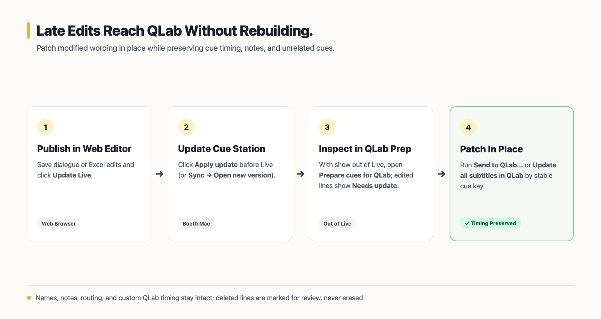

A theatre production rarely starts tech week with a finished cue list.

A stage manager may begin with a raw rehearsal script in **Word (`.docx`)** that has never been translated or split into titles. A translator on another production may send back a finished **Excel (`.xlsx`)** table. Both teams usually face the same moment before technical rehearsal: **how to turn a working document into reliable cues for Mac stage projection and QLab 5 without losing changes when lines move later.**

In our earlier guide on [turning Excel and TXT scripts into QLab subtitles](/blog/13-quick-qlab-subtitles-from-excel-txt/), we looked at how AppleScript can generate QLab Text cues from a spreadsheet. That solves initial creation, yet the show file still tends to drift away from the script once translation edits begin.

**A QLab show file and a rehearsal spreadsheet are good at different jobs. Neither was built to track line-by-line script revisions across a theatre team.**

That is why **Pockitle Cue** keeps the script and translations in the browser while **Pockitle Cue Station** carries the finished cues onto the Mac running your projectors and QLab 5.

## Start from a raw Word script or an existing spreadsheet

Not every show arrives at the same stage of readiness. Pockitle Cue handles three common starting points and brings all of them into the same **Editor**.

*Figure 1. Starting from Word (`.docx`) or Excel (`.xlsx`) leads to the same reviewed script in Pockitle Cue Editor.*

When you only have an untranslated rehearsal script, keep the original Word **`.docx`** file as your primary source. Upload it to your project and run **Analyze script** so the system can separate speaker names, dialogue, and stage directions automatically. Inside **Pockitle Cue Editor**, you can then split long speeches into readable cues, translate them with context-aware AI, or export an **`.xlsx`** copy for a human translator.

When a translator has already built a spreadsheet, use **Import from Excel** on the project upload page (or select **Download the Excel template** there to start from an example workbook). Pockitle Cue expects plain cells with no merged cells and one row per line under a header row—with **Column A** for the character name (left blank for stage directions), **Column B** for source text, and **Columns C onward** for one translation language each—and recognizes older line-type templates as well:

| Role (Column A) | Source (en) (Column B) | Translation (ja) (Column C) | Translation (zh-Hant) (Column D) |
| --- | --- | --- | --- |
| *(leave blank for stage direction)* | `A quiet garden at dawn.` | `夜明けの静かな庭。` | `黎明時分，寧靜的花園。` |
| `ALICE` | `Is anyone there?` | `誰かいるの？` | `有人在嗎？` |

You check the file, confirm each column's language, and review a sample preview before confirming replacement. By default, **Protect imported translations** stays turned on so later AI passes do not overwrite approved human wording, and an optional **Check script with AI** pass can attach review notes without rewriting your lines.

*Figure 2. Reviewing the Excel preview and translation protection before confirming a full script import.*

## Update translations later without breaking cue structure

Once rehearsal begins, replacing the entire script from Excel is rarely what you want. A full import creates fresh **Line IDs**, which resets how the Editor tracks existing cues.

Instead, export the current project as an Excel workbook directly from the Editor's **Download file** menu. Free plans export a trial copy of the first 30 saved cues; Lite, Pro, and Pro+ plans export the full script, with a **Line ID** recorded in every row.

Translators can revise wording inside those translation columns—leaving the **Line ID** column intact—and send the file back into the Editor via **Import translations from Excel**. Pockitle Cue previews every row, skips approved translations unless you explicitly choose to replace them, and updates only the translation text. Your source lines, row order, cue splits, and line history stay in place.

## One synced package on the show Mac

Once the script is ready in the browser, open **Pockitle Cue Station** on the Mac connected to your venue displays and click **Sync** on the show list.

Syncing downloads a verified show package to that Mac. As long as that local package remains valid, local stage projection and QLab preparation do not depend on a continuous booth internet connection. Audience phones still rely on cloud delivery, so venue connectivity continues to matter for mobile viewers—even when the stage projector runs entirely locally.

*Figure 3. Two ways to run the same verified show package on stage day: direct Mac projection or QLab 5.*

## Run up to three local Mac screens without QLab

If a dedicated operator calls surtitles from the script, **Pockitle Cue Station** replaces both PowerPoint decks and fragile browser windows.

In **Settings → Outputs**, you can configure up to three independent stage or confidence outputs on connected Mac displays, each with its own language mix, font size, margins, and position. Built-in **Show Test Card** and **Test Projections** controls let technicians verify framing on the actual house projectors before doors open.

*Figure 4. Running the performance directly from the Pockitle Cue Station console on macOS.*

When unlocked for **Live**, keyboard cues drive the local display windows directly with no round-trip through the cloud, while audience phones on the **Pockitle Cue Viewer** link follow along whenever the booth Mac is online.

## Place and update cues directly inside QLab 5

For shows where one technician calls sound, video, lighting, and surtitles from **QLab 5**, **Pockitle Cue Station** integrates straight into your open QLab workspace.

You need **QLab 5** open on the same Mac with a saved, editable workspace, macOS Automation permission granted on first use, and the show **out of Live** (**Prepare cues for QLab** stays read-only throughout a live performance, including intermission). While the synced package stays valid, preparing QLab cues works offline without re-entering credentials.

Inside **Prepare cues for QLab**, select the captions you want and drag any selected row straight into the QLab cue list—or click the destination cue in QLab and choose **Send to QLab…**. Both actions handle mixed selections: new cues are inserted at the chosen point, and any already-placed cues in the selection are updated in place.

*Figure 5. Selecting prepared cues in Pockitle Cue Station to place or update them in QLab 5.*

For each subtitle moment—including automatic **Blackout** cues wherever your script has a clear gap—Pockitle Cue Station builds a coordinated QLab group (`Pockitle Cue #1`, `Pockitle Cue — Blackout after #1`):

*Figure 6. Inside each generated QLab group, a Text cue drives QLab video output while a localhost Script cue notifies Pockitle Cue Station.*

A single QLab **GO** fires the **Text cue** (requiring a QLab Video license) and a local **Script cue** on `127.0.0.1` (requiring a Script-capable QLab license) so Pockitle Cue Station follows QLab's timeline and updates audience phones when online. If you prefer QLab to trigger cues while Pockitle Cue Station draws the stage projectors, simply leave Cue Station's projection windows open during **Live** and disable or mute QLab's Text children.

## Keep QLab intact when lines change before curtain

Rehearsal notes arrive until the last hour. When the director rewrites five lines in **Pockitle Cue Editor**, you do not rebuild your QLab show file from scratch.

*Figure 7. Propagating late script changes into an existing QLab workspace without rebuilding cues.*

Save the revision in the Web Editor and submit **Update Live**. If Pockitle Cue Station's console is open and online, **Update subtitles** appears in the toolbar so you can apply the update before **Live** or during **Intermission**—or you can click **Sync** on the show list and choose **Open new version** after closing the active run.

Updating captions inside Pockitle Cue Station never rewrites QLab behind your back. When the show is out of **Live**, open **Prepare cues for QLab**; edited rows appear as **Needs update**. Choose **Send to QLab…** or **Update all subtitles in QLab** to patch the changed lines by stable cue key.

Ordinary text updates compare wording only. Your QLab cue names, operator notes, fonts, colors, screen routing, and unrelated sound or lighting cues remain untouched. If a Pockitle Cue group has custom wait or group timing inside QLab, an ordinary text update stops and warns you rather than overwriting it, and captions deleted from the script are marked for review in QLab instead of vanishing silently.

## Confirm three things separately before house open

When preparing a Mac and QLab booth, one clean signal never proves the whole chain:

| Signal | What it confirms | What it does not confirm |
| --- | --- | --- |
| **`In QLab` status** | Cue Station read the cue identity back from the open QLab workspace. | That QLab has an active Video or Script license, or that a projector is outputting video. |
| **Local projection window** | Your Mac output routing, fonts, and line wrapping work on the physical display. | That audience mobile viewers can reach the cloud. |
| **Cloud ACK and test phone** | The booth Mac is online and the **Pockitle Cue Viewer** link updates on audience phones. | That the stage projector signal is live. |

Excel spreadsheets, Word scripts, and QLab timelines all belong in theatre production—each in the place where it works best. When Pockitle Cue holds the reviewed text and Pockitle Cue Station connects it cleanly to Mac projection and QLab 5, late edits stop feeling like an emergency before curtain.

Learn more: [Pockitle Cue Station for Mac](https://surtitlelive.com/pockitle-cue-for-mac) · [Prepare cues for QLab user guide](https://surtitlelive.com/guides?tab=projector-companion&topic=qlab) · [Pockitle Cue Editor](https://surtitlelive.com/guides/open-editor)
